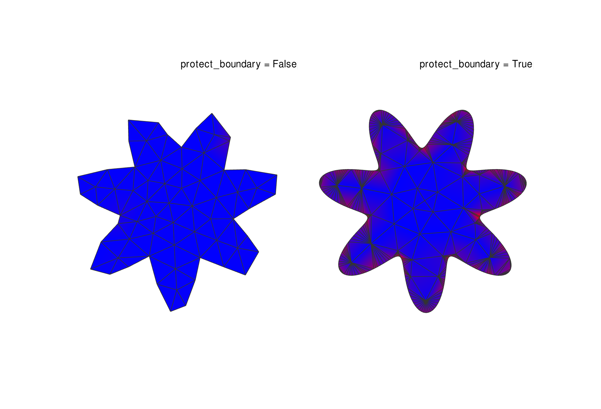

# Mesh Remeshing



This example triangulates a RhinoVault mesh and remeshes the resulting `Tessellation` to a uniform target edge length with COMPAS CGAL.

Key Features:

* Loading PLY mesh files
* Remeshing with a target edge length via `trimesh_remesh`
* Using `Tessellation` as the triangle-processing boundary
* Converting the result back to a mesh for visualization

```python
---8 < ---"docs/examples/example_meshing.py"
```
