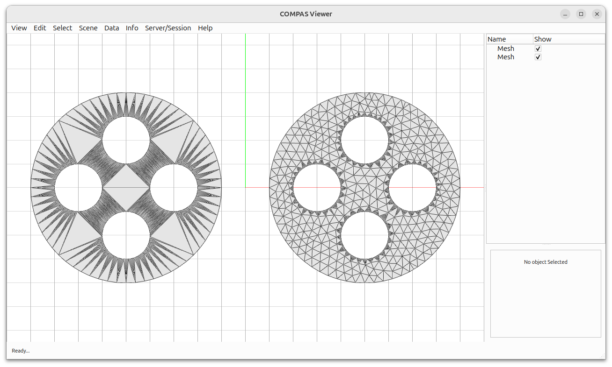

# Mesh Triangulation



This example demonstrates how to perform constrained and refined Delaunay
triangulation through the named structural COMPAS API with the CGAL plugin.

Key Features:

* Creating polygonal boundary and holes
* Constrained Delaunay triangulation returning vertex and triangle buffers
* Conforming Delaunay meshing with an explicit edge-length target
* Side-by-side visualization of different triangulation methods

```python
---8 < ---"docs/examples/example_triangulation.py"
```
